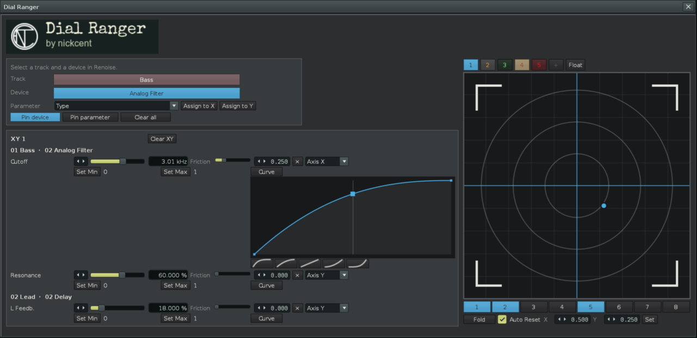
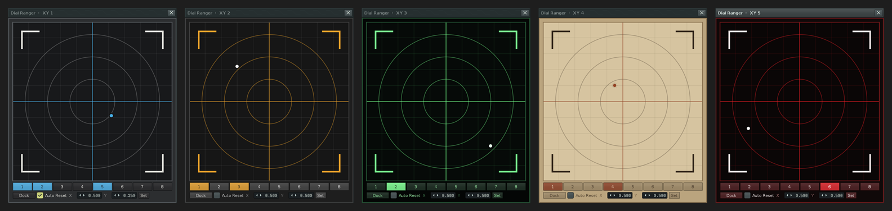

# Dial Ranger

A Renoise tool that keeps chosen device parameters in one window, lets you
tune them with a slowed-down mouse, and plays captured ranges together on XY
pads that record into automation.



Needs Renoise 3.5 or newer. This release was tested with Renoise 3.5.4 on
Windows; macOS and Linux have not been checked.

## Install

Drag `com.cent.DialRanger.xrnx` onto the Renoise window. Open the tool from
**Tools > Dial Ranger...**, or assign a key to **Global > Tools > Show Dial
Ranger** in the key preferences.

## The window

The box at the top left follows what you select in Renoise. Select a track
and a device in its DSP chain; the track shows in its own colour and the
device in the skin's accent colour.

| Button | What it does |
| --- | --- |
| Assign to X / Assign to Y | Puts the chosen parameter on that axis of the XY on show, using its full range |
| Pin device | Adds a card with every parameter of the device |
| Pin parameter | Adds a card with only the chosen parameter |
| Clear all | Removes every card and every XY from this project |

You can also right-click a device in the DSP chain and choose **Pin Device to
Dial Ranger**.

### Cards

A card shows one pinned device. Its coloured header jumps to the device in
Renoise, the checkbox bypasses it, **Editor** opens a plug-in's own window and
**Unpin** removes the card. Each parameter row has:

- a slider, and a field that takes a typed value in the device's own units;
- **Friction**, which slows the mouse on that slider. At 1.000 a drag is 1000
  times finer, for finding a sweet spot by ear;
- **×** to unpin the parameter, and **+ XY** to copy it to the XY on show.

## XY pads

A project holds up to five XYs. Each has its own colour, parameters, ranges,
curves, stored positions and reset position. The numbered buttons above the
pad switch between them, **+** adds the next one and **Clear XY** empties the
one on show.

For each parameter on an XY:

- pick **Axis X** or **Axis Y**;
- set the parameter where the pad's low end should be and press **Set Min**,
  then do the same for **Set Max**. A reversed range works;
- open **Curve** to bend the response. Drag the centre handle, hold Ctrl
  (Command on macOS) for fine movement, or pick one of the five presets.

Several parameters from different devices can share an axis, each with its own
range and curve.

### Playing and recording

| Action | Result |
| --- | --- |
| Left-drag the pad | Moves the parameters |
| Right-drag the pad | Moves them and records both axes into automation |
| Right-click a slot | Stores the dot's position in that slot |
| Left-click a stored slot | Jumps to that position |

A slot jump is written to automation only while Renoise's record mode is on.
It is written as a step: the old value is held until just before the line, so
it plays back as a jump rather than a ramp.

The dot follows its parameters, so it moves when automation plays.

**Auto Reset** returns the pad to the reset position when you let go of the
mouse. Type the X and Y values, or press **Set** to use the dot's current
position.

### Float and Fold

**Float** opens the pad of the XY on show in its own window, in that XY's
colour; every XY can float at once. **Dock** puts the pad back. **Fold** hides
everything except the pad and its strips.



## Where the setup is kept

Cards and XYs are stored inside the project file, so they survive a rename or
a move and travel with the `.xrns` to another machine.

Renoise does not count a change to this setup as a change to the project. If
you only change cards or XYs, Renoise will not ask to save when you close, so
save the project yourself.

## Limits

- Five XYs per project.
- A slot can be overwritten but not emptied.

## Development

The tool is plain Lua in `com.cent.DialRanger.xrnx`. The tests need LuaJIT and
run from the repository root:

```
luajit tests/xy.lua
```

## Licence

MIT. See [LICENSE](LICENSE).
